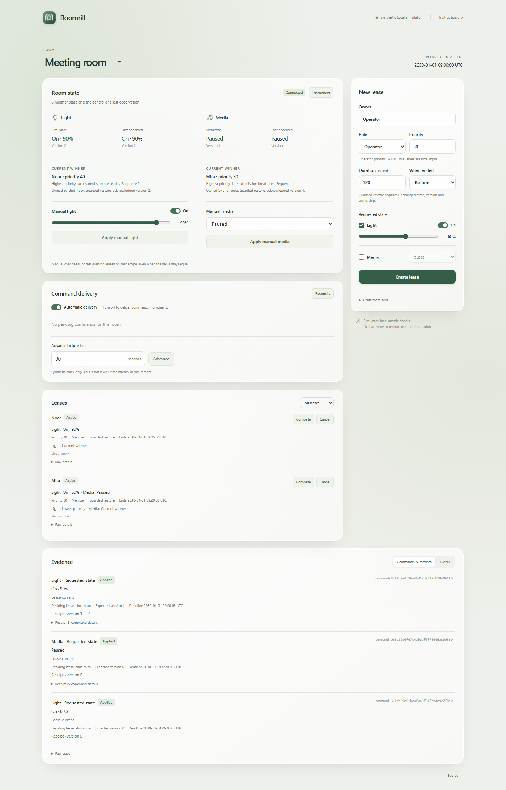

# Roomrill

Durable room-state leases with priority arbitration, manual overrides and version-guarded commands in a synthetic light/media simulator. A temporary request cannot restore an old state over a newer manual choice in the simulator's transactional model.

Python 3.11 or newer; no runtime dependencies.

[Recorded example](https://bglglzd.github.io/roomrill/) · [Release packages](https://github.com/bglglzd/roomrill/releases/tag/v0.1.0)

## Run locally

```sh
git clone https://github.com/bglglzd/roomrill.git
cd roomrill
python -m venv .venv
.venv/bin/python -m pip install .
.venv/bin/roomrill demo --serve
```

On Windows use `.venv\Scripts\python.exe` and `.venv\Scripts\roomrill.exe`. Open the printed numeric loopback URL. The local workspace persists in `.roomrill/demo.sqlite`; use `--db another.sqlite` before `demo` for a fresh path. Ctrl+C stops that server.

In the seeded meeting room, set **Manual light** to 45% and apply it. Advance fixture time by 1,200 seconds. Light stays at your manual value; media returns to its original stopped state. Inspect the deciding lease, suppressed light scope and command receipts. To test arbitration, create a higher-priority light lease before making the manual change.

The hosted example lets you inspect six recorded stages from this engine. Run locally to create requests or change state. [CLI examples, model configuration and recovery](docs/operations.md).



## Scope

The simulator uses a labelled fixture clock and SQLite-local atomic version checks. It does not control hardware or claim that Home Assistant's ordinary service API provides compare-and-swap. An optional llama.cpp chat endpoint can propose a typed draft; the operator must review and create the lease explicitly. [Integration boundary](docs/comparison.md).

The fixed authored suite passes 41 scenarios and 233 ordered steps, with no unwanted restoration in those cases. This is simulator regression evidence. [Results, original failure, workload and limits](docs/evaluation.md).

[Specification](docs/spec.md) · [Architecture](docs/architecture.md) · [Operations](docs/operations.md) · [Evaluation](docs/evaluation.md) · [MIT license](LICENSE)
