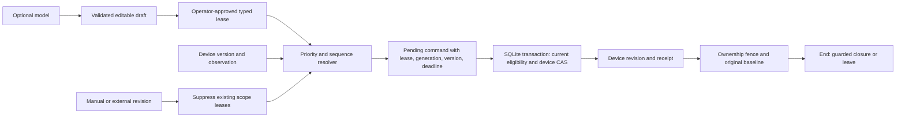

# Architecture

One Python engine serves the CLI, loopback UI and recorded exports. Python's standard library provides SQLite, JSON, process control and HTTP. Browser JavaScript renders engine state and submits typed operations; it does not implement a second arbiter.

## State and application

Each room has an atomic light vector and an independent media scope. Device state and the controller's last observation are distinct while disconnected. On reconnect the controller observes changed versions before authorizing a new plan. Unattributed changes revoke ownership without inventing a human identity. Same-value external writes still advance a version.

A current winner must remain eligible. Higher priority wins; a later submission breaks a tie. Losing requests remain inspectable with their actual reason. Manual changes suppress every existing request for that scope, including a lower-priority loser. A new approved request can begin another ownership chain.

Commands bind a unique ID, lease, resolver generation, expected version and five-second deadline. Delivery checks those facts again inside the write transaction. An explicit delivery attempts only its named command; failed delivery does not silently plan a replacement. Reconcile is a separate operation. A repeated applied ID returns its retained receipt without a new write.

Ownership stores the original baseline, last acknowledged state/version, deciding lease, restore policy and a fence. Winner changes retain the original baseline. An owned no-op may transfer the deciding lease/policy without a device revision. An unowned no-op acquires nothing. Closure requires no eligible winner and surviving ownership of the exact acknowledged state/version. A new winner or external version invalidates a pending closure. Closure has its own deadline and is distinct from an expired desired target.

## Persistence and boundaries

`store.py` keeps one checksummed JSON snapshot in a versioned SQLite database. Short explicit transactions serialize competing writers; simulated device CAS and controller state commit together. This is deliberately a **simulator-local guarantee**, not a distributed hardware protocol. The engine preserves prior command receipts and events. State views show the latest 100 commands/events; stored history is retained.

Each transaction checks SQLite format/integrity and the snapshot checksum. Checksums detect accidental corruption; they do not authenticate an attacker controlling the file. Snapshot validation, encoding and retained history cost grow with ledger size. This version has no migration, retention, encryption, multi-tenant or large-installation claim.

The loopback server uses exact Host/Origin checks, a session token, closed bounded JSON requests and a restrictive content policy. Tokens stay in browser memory. Session refresh loads fresh state and requires another explicit action; it never replays an unconfirmed mutation. Operational serving reconciles on an owned one-second loop. Fixture time advances only by an explicit simulator control.

The optional model worker receives a bounded request over stdin, follows no redirects or ambient proxy configuration, verifies HTTPS normally, bounds the response and is reaped at the wall deadline. Model JSON is untrusted. The operator supplies owner/role and separately confirms the draft. No model function can create a lease or call a device service.

References: [SQLite transactions](https://www.sqlite.org/lang_transaction.html), [Python SQLite](https://docs.python.org/3.11/library/sqlite3.html), [llama.cpp chat endpoint and JSON schema](https://github.com/ggml-org/llama.cpp/blob/master/tools/server/README.md#post-v1chatcompletions-openai-compatible-chat-completions-api).
